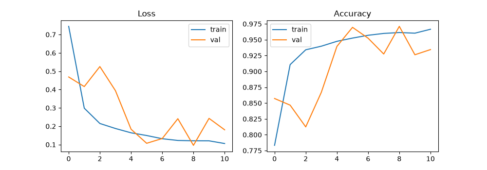
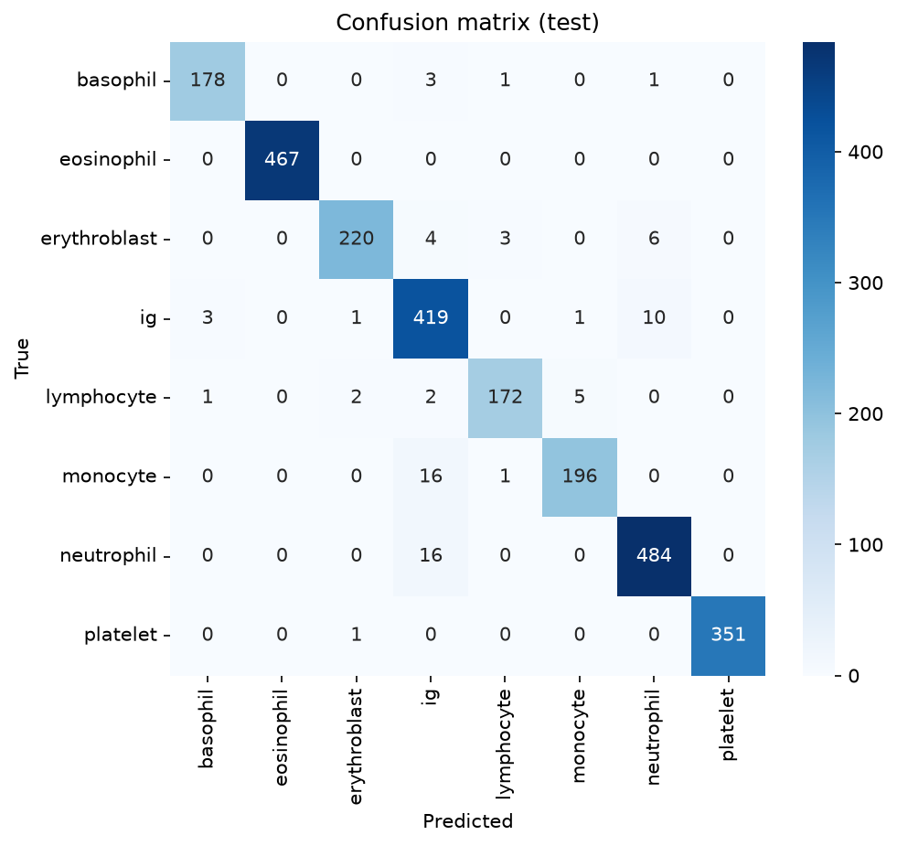

# Blood Cell Classifier: 8-Class Peripheral Blood Cell Recognition with PyTorch

A convolutional neural network, built from scratch in PyTorch, that classifies single peripheral blood cell images into eight types. It reaches **97.0% test accuracy** (macro F1 0.968) on the PBC dataset, and is deployed as a Gradio demo on Hugging Face Spaces.

**Live demo:** https://huggingface.co/spaces/Manny9/Blood-Cell-Classifier2

> **Research prototype, not a diagnostic tool.** This project is for learning and portfolio purposes. It must not be used for clinical decisions.

## Why this project

Manual differential counting depends on a technologist recognising cell morphology, which takes training and involves some inter-observer variability. Automated cell classification is a well-established use of computer vision in the haematology laboratory. This project is the first in a series applying computer vision to laboratory medicine, and it serves as the baseline for later work on transfer learning, synthetic data and object detection.

## Dataset

- **Source:** PBC dataset (Acevedo et al., 2020), *A dataset of microscopic peripheral blood cell images for development of automatic recognition systems*, Data in Brief.
- **Download:** https://data.mendeley.com/datasets/snkd93bnjr/1 (check the licence on that page before redistributing).
- **Size:** 17,092 images of individual normal cells, 360 x 363 pixels, captured with a CellaVision DM96 analyser at Hospital Clinic Barcelona.
- **Classes (8):** basophil, eosinophil, erythroblast, immature granulocyte (IG), lymphocyte, monocyte, neutrophil, platelet.

The dataset is not included in this repository.

## Method

| Item | Choice |
|---|---|
| Split | Stratified 70 / 15 / 15 (train 11,964 / val 2,564 / test 2,564), seed 42 |
| Input | Images resized to 128 x 128, normalised to [-1, 1] |
| Augmentation | Random horizontal and vertical flips (training only). No colour jitter, because stain colour carries information about cell type. |
| Model | 4 convolutional blocks (Conv, BatchNorm, ReLU, MaxPool; 32, 64, 128, 256 channels), global average pooling, dropout 0.4, linear classifier (about 390k parameters) |
| Training | Adam, learning rate 1e-3, batch size 64, cross-entropy loss, best checkpoint chosen on validation accuracy |
| Hardware | Laptop CPU, about 13 minutes per epoch. Run stopped after 11 of 20 planned epochs. Best validation epoch: 9. |

The test set was used once, for final evaluation after the checkpoint was chosen.

## Results

**Test accuracy: 97.0%. Macro F1: 0.968.** (Validation accuracy of the chosen checkpoint: 97.1%.)

| Class | Precision | Recall | F1 | Support |
|---|---|---|---|---|
| Basophil | 0.978 | 0.973 | 0.975 | 183 |
| Eosinophil | 1.000 | 1.000 | 1.000 | 467 |
| Erythroblast | 0.982 | 0.944 | 0.963 | 233 |
| Immature granulocyte | 0.911 | 0.965 | 0.937 | 434 |
| Lymphocyte | 0.972 | 0.945 | 0.958 | 182 |
| Monocyte | 0.970 | 0.920 | 0.945 | 213 |
| Neutrophil | 0.966 | 0.968 | 0.967 | 500 |
| Platelet | 1.000 | 0.997 | 0.999 | 352 |




### Error analysis

The model misclassified 77 of 2,564 test images. Immature granulocytes are involved in 54 of those 77 errors (70%).

| True class | Predicted | Count |
|---|---|---|
| Neutrophil | IG | 16 |
| Monocyte | IG | 16 |
| IG | Neutrophil | 10 |
| Erythroblast | Neutrophil | 6 |
| Lymphocyte | Monocyte | 5 |
| Erythroblast | IG | 4 |

- **IG vs neutrophil (16 and 10, in both directions):** consistent with a maturation continuum, where cells near the boundary can reasonably be called either. 
- **Monocyte called IG (16):** accounts for most of the low monocyte recall (0.920). 
- Eosinophils and platelets are almost perfectly classified, which fits their distinctive appearance.

## Limitations

- **The split is random by image, not by patient.** The dataset has no patient identifiers, so images from the same person can appear in both training and test sets. Reported scores may be optimistic compared with performance on new patients.
- **Normal cells only.** Images come from healthy individuals, so this is cell typing, not disease or abnormality detection.
- **Single source, no external test set.** All images come from one analyser and one staining and imaging protocol. The accuracy figures above apply only to the PBC test split. Images from other microscopes, stains, magnifications or whole-field views are out of distribution and should be expected to give unreliable predictions in the demo.
- **No "not a cell" option.** The model always outputs one of the eight classes, even for inputs it has never seen.
- **Validation instability.** Validation accuracy swung between about 81% and 97% across epochs because of a constant learning rate. The best checkpoint was kept, but results may vary between runs.
- **Label ambiguity.** Some errors involve boundary cells (for example IG vs neutrophil) where experts may disagree.

## Deployment

The best checkpoint (epoch 9) is saved with its class names and image size in `cv01_model_full.pt` (about 1.5 MB) and served with Gradio on Hugging Face Spaces using free CPU hardware.

## Future work

- Learning-rate schedule (cosine) and early stopping to stabilise training.
- Transfer learning with a pretrained network, k-fold cross-validation, and stronger colour and scale augmentation for robustness to other imaging conditions.
- Class-weighted loss and larger input size.
- Patient-level evaluation on a dataset that provides patient identifiers.
- Synthetic images (GAN or diffusion) for rarer classes, compared against this baseline.

## Repository structure

```
cv01-blood-cell-classifier/
├── README.md
├── app.py                           # Gradio demo
├── requirements.txt
├── cv01_blood_cell_classifier.ipynb # data checks, training, evaluation
├── cv01_model_full.pt               # trained weights + class names
├── assets/                          # learning curves, confusion matrix
└── .gitignore
```

## Run it

```bash
git clone https://github.com/YOUR-USERNAME/cv01-blood-cell-classifier.git
cd cv01-blood-cell-classifier
pip install -r requirements.txt
```

**Demo app:**

```bash
python app.py
```

Then open the local address that Gradio prints.

**Notebook:** download the dataset from the link above, unzip it, set `DATA_ROOT` in the configuration cell to the folder containing the eight class subfolders, and run all cells.

## Acknowledgements

Dataset: Acevedo A., et al. (2020), Hospital Clinic of Barcelona. Built with PyTorch, scikit-learn and Gradio.
